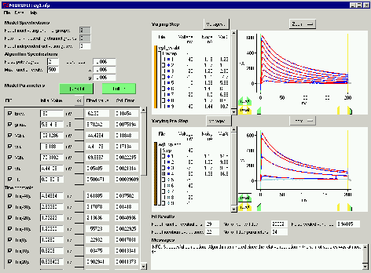

# NEUROFIT
Software for fitting Hodgkin-Huxley Models to Voltage-Clamp data

[Allan Willms](http://www.uoguelph.ca/%7Eawillms/index.html)

## About NEUROFIT

**This is version 1.7** released May 21, 2004.
[Release Notes](http://www.uoguelph.ca/%7Eawillms/neurofit/releasenotes.html).

NEUROFIT is a program which fits Hodgkin-Huxley models to voltage-clamp data.
NEUROFIT is available freely online at

<code>[http://www.uoguelph.ca/~awillms/neurofit/](http://www.uoguelph.ca/%7Eawillms/neurofit/)</code>

NEUROFIT should run on any Microsoft Windows environment.

Bug reports and comments should be sent to
[Allan Willms](mailto:AWillms@uoguelph.ca?subject=NEUROFIT%20bug%20report).

### Installation Instructions

1. [Download `NEUROFITInstall.zip`](http://www.uoguelph.ca/%7Eawillms/neurofit/NEUROFITInstall.zip) (2.8 MB)
2. Install NEUROFIT by simply unzipping the file `NEUROFITInstall.zip` somewhere; it doesn't matter where. You will get a directory called `NEUROFIT`.
3. To run NEUROFIT, launch `NEUROFIT.exe` in the `NEUROFIT` directory.
4. Usage instructions and a tutorial are available from within NEUROFIT by clicking on "Help".
5. [Register via email](mailto:AWillms@uoguelph.ca?subject=NEUROFIT%20Registration) to receive email notification whenever this software is updated.

### Acknowledgements

The code which performs the nonlinear least squares fitting is a C translation and adaptation of an implementation of the Levenberg-Marquardt algorithm written in Fortran and freely available from the [Netlib Mathematical Software Repository](http://www.netlib.org/) (lmder.f).
The translation was done by Howie Kuo and adaptations to allow for linear inequality constraints were completed by Allan Willms. The remainder of the code for the nonlinear fitting algorithm, and all of the code for the quick fit linear algorithm was written by Allan Willms.
The user interface was written by Greg Ewing and Allan Willms using the Python interpretive language (freely available from [http://python.org/](http://python.org/)).
A Python interpreter is bundled as part of the NEUROFIT package.

Support for this project has been given by:

- The University of Canterbury, Internal Research Grant U6322.
- The Royal Society of New Zealand, International Science and Technology Linkages Fund, NZ/USA Co-operative Science Programme, grants 99-CSP-49-WILL and 01-CSP-44-WILL.
- The laboratory of Prof. R.M. Harris-Warrick, Department of Neurobiology and Behavior, Cornell University, Ithaca, USA.

### References

This software is introduced and its convergence properties are described in:
A.R. Willms,
*NEUROFIT: software for fitting Hodgkin-Huxley models to voltage-clamp data*,
_J. Neurosci. Meth._ **121** (2002), 139-150.

The nonlinear fitting algorithm is described in:
A.R. Willms, D.J. Baro, R.M. Harris-Warrick, and J. Guckenheimer,
*An improved parameter estimation method for Hodgkin-Huxley models*,
_J. Comput. Neurosci._ **6** (1999), 145-168.

The quick fit algorithm is based on the one described in:
T.I. Tóth and V. Crunelli,
*A numerical procedure to estimate kinetic and steady-state characteristics of inactivating ionic currents*,
_J. Neurosci. Meth._ **63** (1995), 1-12.

---

2025-05-27 – Standardized to Markdown.